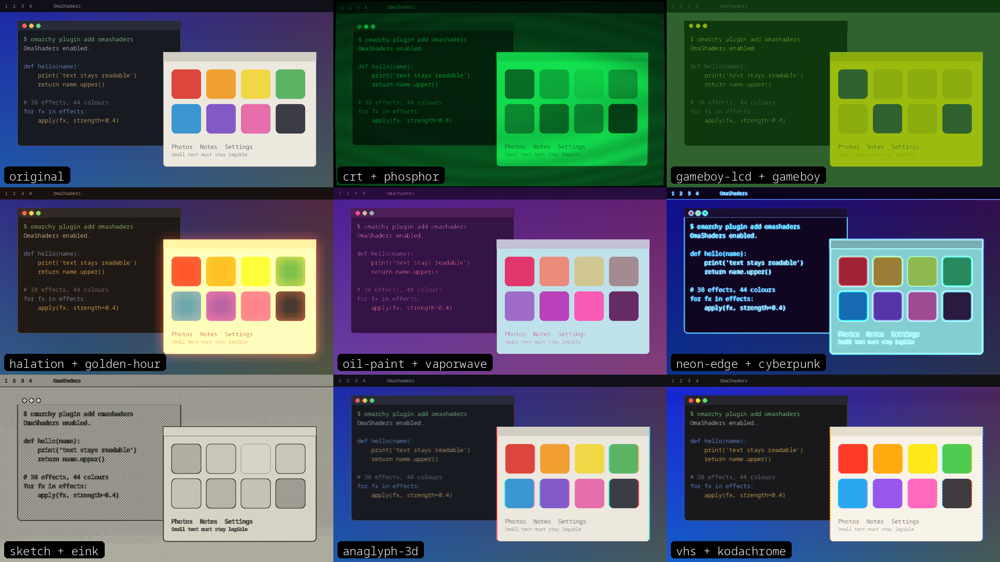

# OmaShaders

<a href='https://ko-fi.com/akton1' target='_blank'></a>

Full-screen shader effects for the [Omarchy](https://omarchy.org/) desktop, from one bar icon: 38 screen effects (CRT, pixel art, e-ink, Game Boy, halation, oil paint, matrix rain ...), 44 colour grades, 41 animated wallpaper effects and 24 cursor effects (12 overlays, 12 that bend the real screen under the pointer). Hover to preview, click to keep, and a strength slider on each effect that starts at a value where text stays readable.

> **Brand new: this plugin is one day old** (first written on 9 October 2026, first public release on 10 October 2026). Most of it has only been tried by its author on one machine (NVIDIA GPU, two monitors). Expect rough edges, effects that change or get renamed, and settings that move between versions. Bug reports are welcome.



*The picture is a sample desktop rendered with the plugin's own shaders (`bin/shader-preview`), not a screenshot of the menu.*

## Install

```
omarchy plugin add https://github.com/AktOn1/omashaders.git --enable
```

Then add the **OmaShaders** widget (monitor icon) to your bar in the Omarchy shell settings. Restart the shell once (`omarchy-restart-shell`) if the icon does not appear.

## Requirements

- Omarchy with the shell plugin system and Hyprland 0.56 or newer (Lua config). The screen effects are set with `hyprctl eval`.
- `python` 3 and `bash`. For the wallpaper picker: Omarchy's own `omarchy-menu-images` and `omarchy-theme-bg-set`.
- Optional: `nvidia-smi` (NVIDIA) for the GPU line in the menu footer; on AMD it is read from sysfs. Without either the line is empty.
- No build tools are needed: the compiled wallpaper and cursor shaders (`.frag.qsb`) are included.

## First run

1. Click the monitor icon in the bar. A menu with up to five columns opens: **Screen**, **Color**, **Wallpaper**, **Cursor** and **Combos**. Tick the ones you want at the top; ticked menus sit side by side and your choice is remembered.
2. Move with `h j k l` or the arrow keys. Moving onto an effect with the keys previews it live; hovering with the mouse only highlights it (hold `Shift` while hovering to preview).
3. `Enter` keeps the effect and closes, `Space` keeps it and stays open, a click keeps it and stays open, `Esc` puts everything back as it was.
4. Pick an effect and a colour together: the effect runs first, then the colour grade is applied to its result (for example `crt` + `gameboy` is a CRT look in Game Boy greens).
5. Lower the **Strength** slider if an effect is too strong. Every effect starts at a readable value (pixelate 20 %, Game Boy LCD 25 %, C64 25 % ...); 0 % is the original screen.

## Usage

Bar icon: **left click** menu, **right click** all effects off, **middle click** next wallpaper, **scroll** steps the screen effect.

| Key | Action |
| --- | --- |
| `h j k l`, arrows | move between categories, effects and menus |
| `Tab` | jump to the next menu |
| `Enter` / `Space` | keep (and close) / keep and stay open |
| `Esc`, `q` | undo and close |
| `[` `]`, `{` `}`, `d` | strength -/+ 5 %, -/+ 1 %, back to the start value (acts on the focused Screen or Color menu) |
| `p` | pause or resume every effect; they come back exactly as they were |
| `f` | favourite (each menu has its own list) |
| `F` | save the current Screen + Color + Wallpaper + Cursor combination as a combo (`m` shows the Combos menu) |

| `r` / `R` | Surprise me in the focused menu / in every ticked menu |
| `o` / `O` | off in the focused menu / in every ticked menu |
| `s` `C` `w` `c` `m` | tick Screen / Color / Wallpaper / Cursor / Combos |
| `a` | include the animated (heavy) screen effects |
| `x` | cursor effects only while Shift is held |
| `g` / `G`, `1`-`9` | top / bottom, jump to a category |

The last line of the menu shows GPU use: this shell (draws wallpaper and cursor effects), Hyprland (the screen effect), all apps, and VRAM (the per-process split is NVIDIA only; AMD shows the overall figure). It only updates while the menu is open.

Sample key bindings for `~/.config/hypr/bindings.lua` (they are not added for you):

```lua
-- pause / resume all effects
hl.bind("SUPER + ALT + S", hl.dsp.exec_cmd("omarchy-shell io.github.akton1.omashaders power toggle"))
-- open the menu
hl.bind("SUPER + ALT + D", hl.dsp.exec_cmd("omarchy-shell io.github.akton1.omashaders toggle"))
```

Command line: `omarchy-shell io.github.akton1.omashaders toggle|open|close|power on|off|toggle|set NAME|setColor NAME|setMouse NAME|wallpaper NAME|strength effect|color N|sections screen|color|wall|mouse|both|all|combo N|combo save|shiftOnly on|off|toggle`. The effect script can also be run directly: `bin/omashaders list|status|set NAME|off|effect ...|color ...|strength ...|power ...`.

### Animated effects

Effects that move (grain, scan-sweep, vhs, heat-haze, glitch, hologram, matrix, fireflies, underwater, snowfall and a few more) need Hyprland's damage tracking switched off, which redraws the whole screen every frame and **raises GPU use a lot**. They are hidden until you press `a` (or turn on the setting below). While one is on, the plugin sets `debug:damage_tracking=0` itself so Hyprland shows no warning, and sets it back for static effects and for off. Static effects cost almost nothing.

### Shift only (cursor effects)

Cursor effects and the wallpaper effects' mouse reaction can be limited to "only while Shift is held" (`x` in the menu). For that, Hyprland has to tell the plugin when Shift is down; add this to `~/.config/hypr/bindings.lua`, and the same line for `Shift_R`:

```lua
hl.bind("Shift_L", hl.dsp.global("omashaders:shift"), { non_consuming = true, dont_inhibit = true })
```

Shift still reaches your apps normally. Without this binding the effects never show while the option is on.

### Follow effects

Cursor > Bend > Follow: eight gentle effects that bend or re-draw the real screen along the pointer's recent path and settle after you stop: `smudge` (pixels smear forward like dragged wet paint), `melt` (a soft drip behind the pointer), `wake` (a narrow boat-wake ribbon), `drift` (a faint lens that lags behind and catches up), `streak` (motion blur near the pointer) `echo` (a faint afterimage) and `decode` (screen cells near the moving pointer scramble into green Matrix-style glyphs and decode back to the real pixels as you move on) and `smoke` (a faint wisp of smoke that is pulled along behind the pointer, curls and thins out upward after you stop). They are small (45-150 px) and fade out within half a second, so text stays readable. `bin/cursor-bend` passes the last 8 pointer positions (35 ms apart) to the shader as `CTR`.

## Configuration

Plugin settings (Omarchy settings UI):

| Setting | Default | Meaning |
| --- | --- | --- |
| `includeAnimated` | off | start value of the "animated screen effects" switch (the switch itself is remembered) |
| `fps` | 30 | frame rate of wallpaper and cursor effects |
| `cursorNeedsShift` | off | start value of "cursor effects only while Shift is held" |

**Starter combos:** the Combos menu comes with ready-made combinations (file `starter-combos`, kept in step with the author's own list). Each release adds the new ones to your list, once: a combo you removed with `f` does not come back, and your own combos are never changed. To ship your own set from a checkout, create an empty file `dev-export` in the state folder; then every save or remove also rewrites `starter-combos`.

State lives in `~/.local/state/omarchy/io.github.akton1.omashaders/` (current effects, strengths, favourites, combos, pause flag, built shader files). Hyprland forgets a runtime screen shader on a config reload; the icon re-applies it.

## Permissions and behaviour

- **No network access.** Nothing is downloaded, nothing is sent.
- **Hyprland:** the screen effect is set at runtime with `hyprctl eval` (`decoration:screen_shader` and `debug:damage_tracking`). Nothing is written to your Hyprland config files; a `hyprctl reload` or `off` clears it.
- **Subprocesses:** `bin/omashaders` (sets the shader), `bin/compose-shader` (python, merges effect and colour into one file), `bin/cursor-watch` (python; reads the pointer position from the Hyprland socket about 40 times a second, only while a pointer-following effect is running, and exits with the shell), `bin/gpu-usage` (`nvidia-smi` or sysfs, only while the menu is open), `bin/wallpaper-step`, and `notify-send` for the pause key.
- **Wallpaper picker and next/previous:** these change your wallpaper with Omarchy's `omarchy-theme-bg-set`, on your click only. Picking makes a temporary folder of symlinks to your background images under `$XDG_RUNTIME_DIR` and removes it afterwards.
- **Files written:** only the state directory above and the temporary folder just mentioned. Existing config of yours is never overwritten.
- **Bend cursor effects:** a screen shader cannot see the pointer, so while one is selected `bin/cursor-bend` (python; polls the pointer from the Hyprland socket 60 times a second, writes a new shader file at most 30 times a second and only while the pointer moves, plus a short tail for the ripple-like ones) hands Hyprland a fresh composed shader through `hyprctl eval`. Screen and Color effects stay active, merged into the same shader. It starts and stops with the effect, exits with the shell, and then puts your normal shader back. With several monitors a 3x2 pixel marker (magenta, green, magenta) is drawn in the top-left corner of the pointer's monitor so only that monitor is bent; the shader hides it again.
- **Windows:** wallpaper and cursor effects are drawn in click-through layer-shell windows, one per monitor, that do not take keyboard focus. The menu takes keyboard focus while it is open.
- **Bundled binaries:** the `.frag.qsb` files are compiled Qt shader packages (data, not programs), built from the `.frag` sources next to them with `bin/build-*-effects`.

## Update

```
omarchy plugin update io.github.akton1.omashaders
```

## Remove

```
omarchy plugin remove io.github.akton1.omashaders
rm -rf ~/.local/state/omarchy/io.github.akton1.omashaders
hyprctl reload
```

Also remove the key bindings you added.

## Troubleshooting

- **Red Hyprland warning about `time` and damage tracking:** an animated effect was applied by something other than this plugin. Pick a static effect or `off`, then run `hyprctl reload`.
- **An effect makes text unreadable:** lower its strength (`[`), or press `d` for its start value. Pixel effects start low on purpose.
- **Icon missing or the menu looks old after an update:** `omarchy-restart-shell`.
- **Bend effects cost more than overlays:** the pointer position reaches the shader as a new file about 30 times a second, so Hyprland recompiles it each time (roughly 35% of a CPU core on the author's machine while the pointer moves, none while it rests). Use an overlay effect if that matters.
- **Bend effect only shows on one monitor:** intended, it follows the pointer.
- **Cursor effects never show:** you turned on "only while Shift is held" without the Shift binding above.
- **GPU line empty:** neither `nvidia-smi` nor an AMD sysfs reading is available.

Report bugs at https://github.com/AktOn1/omashaders/issues. How the effects work and how to add your own: [docs/DEVELOPMENT.md](docs/DEVELOPMENT.md).

## Support

If this is useful to you, you can [buy me a coffee on Ko-fi](https://ko-fi.com/akton1).

## License

MIT, see [LICENSE](LICENSE). The shaders were written for this plugin; no third-party code or assets are bundled.
